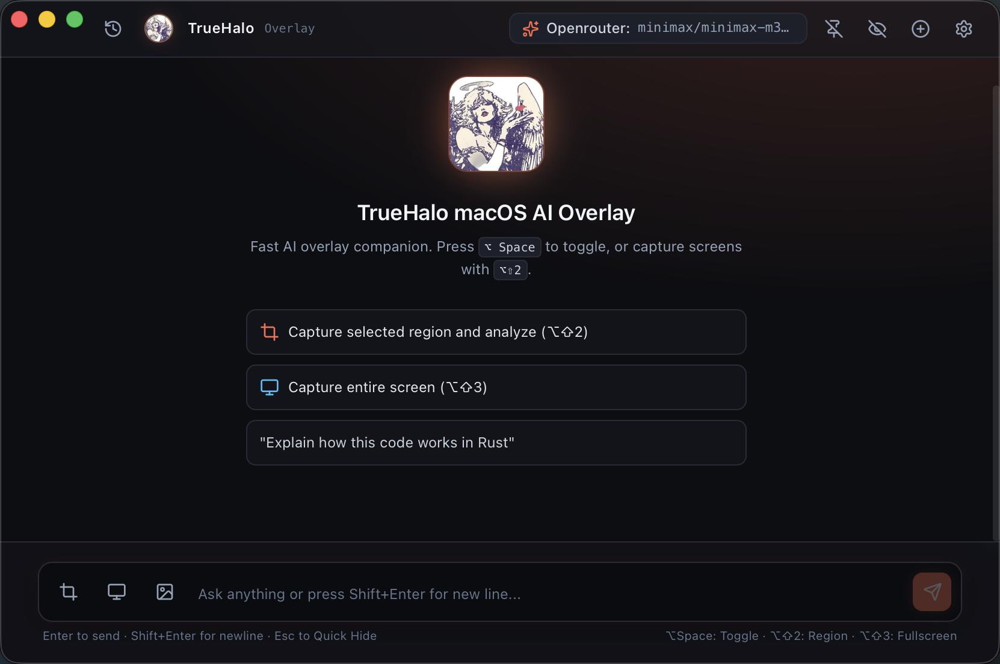
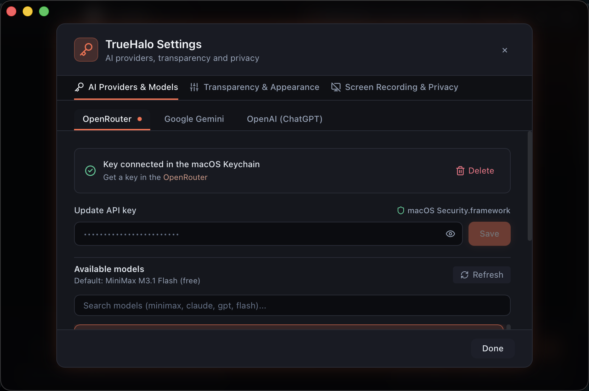
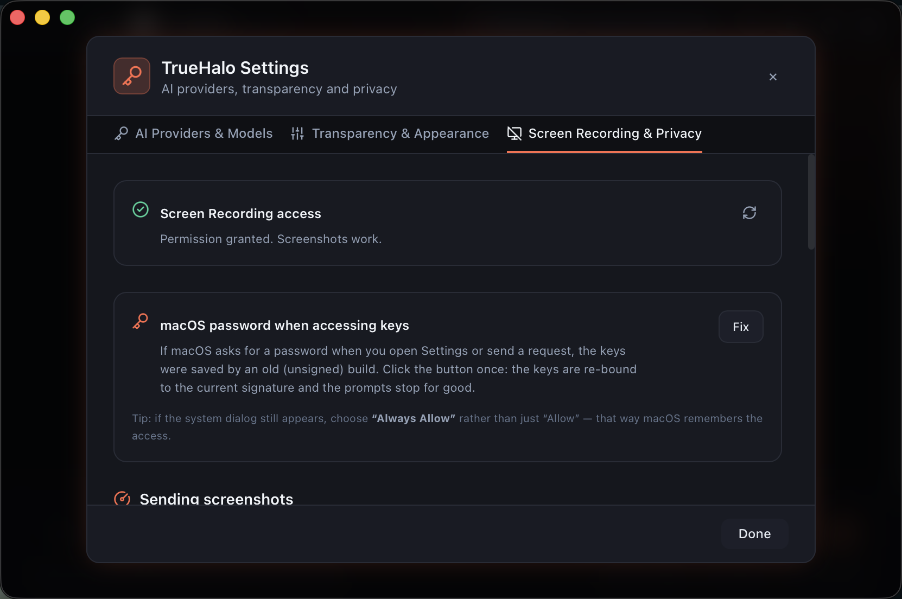

<div align="center">


# TrueHalo

**A native, privacy-first AI screen overlay for macOS.**<br/>
A lightweight, specialized alternative to [Cheating Daddy](https://github.com/sohzm/cheating-daddy).

[](https://github.com/Neksand/TrueHalo)
[](https://tauri.app)
[](https://www.rust-lang.org)
[](https://react.dev)
[](LICENSE)
[](https://github.com/Neksand/TrueHalo/releases)

[Download](#install) · [Features](#features) · [Comparison](#truehalo-vs-cheating-daddy) · [Build from source](#build-from-source) · [Roadmap](#roadmap)

</div>



---

## Why TrueHalo

Most AI overlay apps are Electron bundles that record your screen and your microphone
continuously. TrueHalo takes the opposite approach: a small native app that looks at
your screen **only when you ask it to**, keeps your API keys in the macOS Keychain,
and stays out of other apps' recordings.

- **Native, not Electron.** Rust + Tauri 2 + the system WebView. ~19 MB app, 8 MB DMG.
- **Bring your own model.** OpenRouter, Google Gemini and OpenAI — any vision-capable model.
- **On-demand only.** No background analysis, no recording, no timers. One hotkey, one screenshot.
- **Keys stay on your Mac.** Stored in the macOS Keychain and never exposed to the webview.
- **Made for the overlay use case.** Excluded from other screen recordings, optional accessory
  mode, remembers its position and size, toggle with `⌥Space`.

## TrueHalo vs Cheating Daddy

[Cheating Daddy](https://github.com/sohzm/cheating-daddy) is a great open-source project and
the reason TrueHalo exists. TrueHalo is an **independent implementation** for people who want
the same idea with a much smaller footprint, provider freedom and stricter privacy defaults.

| | Cheating Daddy | TrueHalo |
|---|---|---|
| Runtime | Electron | Tauri 2 (Rust + system WebView) |
| Install size | Electron bundle | ~19 MB app · 8 MB DMG |
| AI providers | Google Gemini Live | OpenRouter · Google Gemini · OpenAI |
| Screen analysis | Real-time during a session | On demand: `⌥⇧2` region, `⌥⇧3` screen |
| Audio capture | Yes (system audio + microphone) | Not included — screen only, by design |
| Assistant profiles | 5 presets (interview, sales, meeting, …) | Free-form chat (profiles on the roadmap) |
| Overlay privacy | Transparent, click-through | Hidden from other apps' screen recordings, accessory mode |
| API key storage | — | macOS Keychain, never sent to the webview |
| Platforms | macOS · Windows · Linux | macOS (Windows on the roadmap) |
| License | GPL-3.0 | GPL-3.0 |

## Features

### AI core
- **Three providers out of the box** — OpenRouter, Google Gemini and OpenAI, with a live model catalog.
- **Streaming responses** with instant cancellation (`Esc` or the Stop button).
- **Multimodal** — screenshots go straight to vision models such as Claude, Gemini and GPT-4o.
- **Token awareness** — per-message and per-session usage; only the newest screenshot is sent,
  older images are replaced with a placeholder to save tokens.

### Screenshots
- **Two hotkeys**: `⌥⇧2` for a region, `⌥⇧3` for the full screen.
- **Compressed before upload** — a raw Retina PNG (10–20 MB) usually becomes < 1 MB
  with the Balanced preset (Quality / Balanced / Speed).
- **The overlay never appears in its own screenshot** — the window is hidden during capture.
- **Stable Screen Recording permission** — builds are signed with a persistent local identity,
  so macOS does not ask again after every rebuild.

### Window & privacy
- **True transparency** — the opacity slider maps 1:1 to the window alpha (5–100 %), no perpetual blur.
- **Optional frosted glass** (AppKit vibrancy) for readability at high transparency.
- **Invisible to other recordings** — `NSWindowSharingNone` removes the window from OBS, Zoom, QuickTime, etc.
- **Accessory mode** — hide from the Dock and `⌘Tab`, keep a menu bar icon.
- **Draggable** from the header and dialogs; position and size are persisted.
- **No telemetry, no analytics, no background polling.**

| Providers | Privacy |
|---|---|
|  |  |

## Install

### Requirements
- macOS 13 Ventura or newer
- Apple Silicon (the published DMG is `arm64`; Intel Macs can build from source)

### Download

1. Grab the latest `TrueHalo-*-arm64.dmg` from [Releases](https://github.com/Neksand/TrueHalo/releases).
2. Open the DMG and drag **TrueHalo** into **Applications**.
3. On the first launch macOS will warn that the app was not notarized. This is expected:
   the build is signed with a self-signed local certificate, not a paid Apple Developer ID.

   **macOS 15+:** System Settings → Privacy & Security → scroll down → **Open Anyway**.
   **macOS 13–14:** right-click the app → **Open** → **Open** again.

   Or remove the quarantine flag from Terminal:
   ```bash
   xattr -dr com.apple.quarantine /Applications/TrueHalo.app
   ```

4. Grant **Screen Recording** when asked:
   System Settings → Privacy & Security → **Screen & System Audio Recording** → enable **TrueHalo** →
   restart the app.

### First run

1. Click the gear icon → **AI Providers & Models**.
2. Pick a provider and paste an API key:
   [OpenRouter](https://openrouter.ai/keys) · [Google AI Studio](https://aistudio.google.com/app/apikey) · [OpenAI](https://platform.openai.com/api-keys)
3. Press **Save** — the key goes straight into the macOS Keychain.
4. Select a model, close Settings, and start chatting.

### Build from source

```bash
git clone https://github.com/Neksand/TrueHalo.git
cd TrueHalo
npm install

# One-time: create a stable local signing identity (keeps Screen Recording across rebuilds)
npm run sign:setup

# Build, sign and install into /Applications
npm run app:install

# Or: build a DMG
npm run app:build -- --release --dmg --install
```

Prerequisites: Xcode Command Line Tools (`xcode-select --install`), Node.js 18+, Rust stable.

> `npm run tauri dev` runs an unsigned debug binary, so macOS cannot persist Screen Recording
> permission for it. Use the signed `/Applications` build when testing screenshots.

## Hotkeys

| Shortcut | Action |
|---|---|
| `⌥Space` | Show / hide the overlay (works globally) |
| `⌥⇧2` | Capture a region and attach it |
| `⌥⇧3` | Capture the full screen and attach it |
| `Esc` | Stop streaming / quick-hide |
| `↵` | Send message |
| `⇧↵` | New line |

## How it works

```
⌥⇧2 ──► hide overlay (NSApp hide:)
      ──► /usr/sbin/screencapture
      ──► downscale + JPEG compression (Rust, in memory)
      ──► base64 → React state
      ──► POST /chat/completions (SSE)
      ──► streaming tokens → Markdown
```

All AppKit calls are marshalled to the main thread, window geometry is flushed to SQLite from a
background thread, and the overlay is hidden with `NSApp hide:` rather than `NSWindow.orderOut`
(the latter makes AppKit terminate the process ~1.7 s later).

More detail: [docs/ARCHITECTURE.md](docs/ARCHITECTURE.md) · [SECURITY.md](SECURITY.md).

## Privacy & security

- **Keys**: macOS Keychain (`Security.framework`), service `com.truehalo.desktop`.
  Existence checks read attributes only, so Settings never asks for your login password.
  A one-click **Fix** in Settings → Screen Recording & Privacy re-binds keys created by older builds.
- **Network**: direct HTTPS to the provider you chose. Nothing else. No telemetry.
- **Screen**: captured only after an explicit hotkey, compressed locally, and the temporary file
  is deleted immediately after it is read.
- **Webview**: no API key ever reaches JavaScript; strict CSP; Markdown is rendered as text nodes.

Full threat model: [SECURITY.md](SECURITY.md).

## Troubleshooting

| Symptom | Fix |
|---|---|
| “TrueHalo is damaged and can’t be opened” | `xattr -dr com.apple.quarantine /Applications/TrueHalo.app`, then open again |
| Screenshots keep asking for permission | System Settings → Privacy & Security → Screen & System Audio Recording → toggle TrueHalo **off and on** |
| macOS asks for the login password when opening Settings | Settings → Screen Recording & Privacy → **Fix** (choose **Always Allow** once) |
| Hotkeys do nothing | Another app owns `⌥Space`; quit it or change the global shortcut |
| Model list is empty | The provider rejected the key (401/429) — check the key and your quota |

Logs: `~/Library/Logs/TrueHalo/truehalo.log`.

## Roadmap

- [ ] Windows build (Credential Manager + Win32 capture backend)
- [ ] Universal binary (Apple Silicon + Intel)
- [ ] Assistant profiles (interview, meeting, sales)
- [ ] Optional click-through mode
- [ ] Local models via Ollama

## Tech stack

| Layer | Technology |
|---|---|
| Shell | Tauri 2 |
| Backend | Rust, Tokio, reqwest, rusqlite |
| Frontend | React 18, TypeScript, Vite, Tailwind CSS |
| Capture | `screencapture` + `image` crate |
| Credentials | `security-framework` (macOS Keychain) |
| Window | AppKit (`NSApplication`, `NSWindow`) via Objective-C runtime |

```
src/                  React UI (chat, providers, capture, settings)
src-tauri/src/
├── ai/               provider clients (OpenRouter, Gemini, OpenAI) + SSE streaming
├── auth/             macOS Keychain integration
├── capture/          screen capture, compression, permissions
├── commands/         typed IPC surface
├── storage/          SQLite (sessions, messages, preferences)
├── overlay.rs        safe show/hide/is_visible for the overlay
└── macos.rs          minimal Objective-C runtime helpers
scripts/              build, signing and packaging
docs/                 architecture notes and screenshots
```

## Development

```bash
npm install
npm run tauri dev     # hot reload
npm run build         # type-check + production frontend
cargo test --manifest-path src-tauri/Cargo.toml
```

Contributions are welcome — see [CONTRIBUTING.md](CONTRIBUTING.md).

## Credits

- Inspired by **[Cheating Daddy](https://github.com/sohzm/cheating-daddy)** by
  [@sohzm](https://github.com/sohzm). TrueHalo is an independent implementation and shares
  no code with it; the comparison above is based on its public README.
- Built with [Tauri](https://tauri.app), [React](https://react.dev) and
  [Tailwind CSS](https://tailwindcss.com).

## License

[GPL-3.0](LICENSE) © TrueHalo contributors.

TrueHalo is free software: you can redistribute it and/or modify it under the terms of the
GNU General Public License as published by the Free Software Foundation, either version 3 of
the License, or (at your option) any later version.
