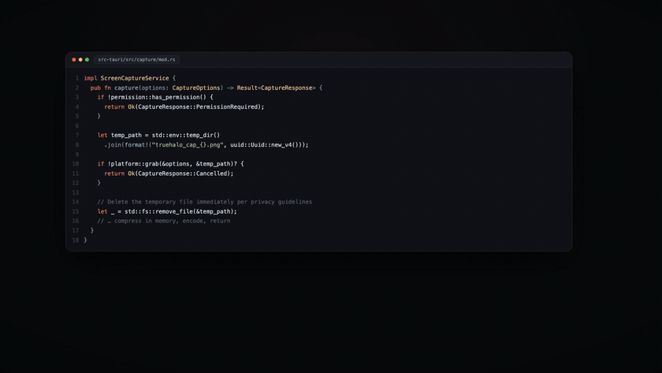
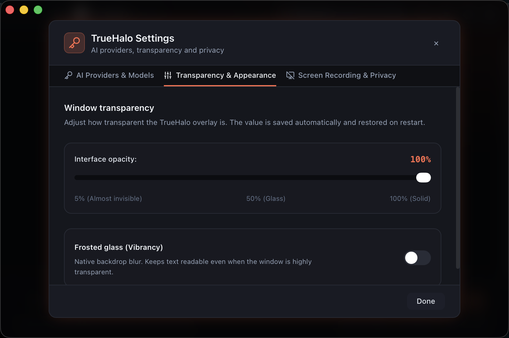
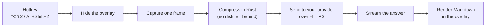

<div align="center">


# TrueHalo

**A native AI overlay that answers questions about what is on your screen.**<br/>
Press a hotkey, grab a region, and get an answer in a floating window — in any app, on macOS and Windows.

[](https://www.gnu.org/licenses/gpl-3.0)
[](https://tauri.app)
[](https://www.rust-lang.org)
[](https://github.com/Neksand/TrueHalo/releases)
[](#platform-support)
[](#why-truehalo-is-small)

[Watch the demo](#watch-the-demo) · [Features](#features) · [Install](#install) · [Comparison](#truehalo-vs-cheating-daddy) · [Roadmap](#roadmap)

</div>

## Watch the demo

<p align="center">
  <a href="docs/media/truehalo-launch.mp4">
    
  </a>
</p>

<p align="center">
  <sub>▶ <a href="docs/media/truehalo-launch.mp4"><b>Watch the 37-second launch film</b></a> (1080p, with sound)</sub>
</p>

## What is TrueHalo?

TrueHalo is a small desktop app that sits on top of everything you do. When you need help with
something on screen — an error, a chart, a piece of code, a form — you press one hotkey, drag a box
around it, and ask a question. The answer appears in a translucent window that stays on top.

It is **not** a background recorder or an always-listening assistant:

- **You start every request.** No timers, no continuous capture, no microphone.
- **You choose the model.** Bring an API key from OpenRouter, Google Gemini or OpenAI.
- **Your keys stay in the OS.** They live in the system credential store and never reach the UI layer.

Typical uses: debugging code, reading dense documentation, understanding dashboards, translating an
error message, or summarising a long page you are allowed to look at.

## Why TrueHalo is small

Most AI overlays are Electron apps: they ship a whole Chromium browser (200+ MB) just to draw one
window. TrueHalo is written in Rust and uses the WebView that your operating system already has.

<p align="center">
<svg width="860" height="150" viewBox="0 0 860 150" xmlns="http://www.w3.org/2000/svg" role="img" aria-label="Installer size comparison">
  <rect width="860" height="150" rx="16" fill="#0b1020"/>
  <text x="28" y="34" fill="#e2e8f0" font-family="ui-sans-serif, system-ui, sans-serif" font-size="13" font-weight="600">Installer size</text>
  <text x="28" y="74" fill="#94a3b8" font-family="ui-sans-serif, system-ui, sans-serif" font-size="12">Typical Electron overlay</text>
  <rect x="230" y="60" width="570" height="22" rx="11" fill="#334155"/>
  <text x="812" y="76" fill="#cbd5e1" font-family="ui-sans-serif, system-ui, sans-serif" font-size="11" text-anchor="end">200+ MB</text>
  <text x="28" y="116" fill="#f8fafc" font-family="ui-sans-serif, system-ui, sans-serif" font-size="12" font-weight="600">TrueHalo</text>
  <rect x="230" y="102" width="68" height="22" rx="11" fill="#fbbf24"/>
  <text x="314" y="118" fill="#fbbf24" font-family="ui-sans-serif, system-ui, sans-serif" font-size="11" font-weight="700">19 MB</text>
</svg>
</p>

| | Typical Electron overlay | TrueHalo |
|---|---|---|
| Download | 200+ MB | **9 MB DMG · 4.7 MB EXE** |
| Installed app | 300–500 MB | **~19 MB** |
| Runtime | bundled Chromium | the system WebView |
| Idle memory | hundreds of MB | a fraction of that |
| Cold start | seconds | almost instant |

## Screenshots


| AI providers & models | Transparency & appearance |
|---|---|
|  |  |

<p align="center">

</p>

## Features

### Ask about anything on screen
- **Two capture modes.** Select a region (`⌥⇧2` on macOS, `Alt+Shift+2` on Windows) or grab the whole
  screen (`⌥⇧3` / `Alt+Shift+3`).
- **Works over any app.** The overlay floats above your work and can be moved by its header.
- **Images are compressed locally** before they are sent, so uploads stay small (a Retina screenshot
  usually drops from 10–20 MB to under 1 MB).

### Chat that feels native
- **Streaming answers** — text appears as the model writes it; stop it any time with `Esc`.
- **Three providers, one UI** — OpenRouter, Google Gemini and OpenAI, with a live model list.
- **Vision models** — screenshots are sent as images to models such as Claude, Gemini and GPT-4o.
- **Token counter** — see usage per message and per session; old screenshots are replaced with a
  short placeholder so you do not pay for the same image twice.

### Built for a window that floats on top
- **Real transparency** — the opacity slider (5–100 %) changes the actual window alpha.
- **Optional frosted glass** on top of the transparency, for readability.
- **Invisible to screen recorders** — OBS, Zoom and QuickTime do not see the overlay at all
  (`NSWindowSharingNone` on macOS, `WDA_EXCLUDEFROMCAPTURE` on Windows 10 2004+). On Windows the
  overlay turns fully opaque while protection is on, so the recorded area shows the desktop instead
  of a black box; transparency and glass return when you switch protection off.
- **Tray mode** — hide TrueHalo from the Dock or taskbar and control it from the menu bar / tray.
- **Remembers its place** — position, size and settings are stored locally in SQLite.
- **No telemetry, no accounts, no analytics.**

## TrueHalo vs Cheating Daddy

[Cheating Daddy](https://github.com/sohzm/cheating-daddy) popularised the idea of an AI overlay.
TrueHalo is an **independent implementation** with a different trade-off: a much smaller app, your own
providers, and no continuous audio or screen capture.

| | Cheating Daddy | TrueHalo |
|---|---|---|
| Runtime | Electron | Tauri 2 (Rust + system WebView) |
| Download | Electron bundle | **9 MB DMG · 4.7 MB EXE** |
| AI providers | Google Gemini Live | OpenRouter · Google Gemini · OpenAI |
| Screen analysis | continuous during a session | on demand, per hotkey |
| Audio capture | system audio + microphone | not included, by design |
| Assistant profiles | 5 fixed presets | free-form chat now · **context injection planned** |
| Overlay privacy | transparent, click-through | hidden from recorders, tray mode |
| API key storage | — | system credential store, never in the UI |
| Platforms | macOS · Windows · Linux | macOS (Apple Silicon) · Windows (x64) |
| License | GPL-3.0 | GPL-3.0 |

## Platform support

| Platform | Status | Installer |
|---|---|---|
| macOS 13 Ventura or newer · **Apple Silicon** | ✅ Available | `TrueHalo-0.2.1-Installer.dmg` |
| Windows 10 2004+ / Windows 11 · x64 | ✅ Available | `TrueHalo_0.2.1_x64-setup.exe` |

The React UI and the Rust core are shared. The macOS backend uses AppKit and the Keychain; the Windows
backend uses Win32 (DWM acrylic, display affinity) and the Credential Manager.

## Install

### macOS (Apple Silicon)

**You need:** macOS 13 Ventura or newer on an M1/M2/M3/M4 Mac.

1. Download `TrueHalo-0.2.1-Installer.dmg` from [Releases](https://github.com/Neksand/TrueHalo/releases).
2. Open the DMG and drag **TrueHalo** into **Applications**.
3. Launch it. macOS will say it cannot verify the app — this is normal, because the build is signed
   with a local certificate instead of a paid Apple Developer ID.

   **macOS 15 or newer**
   1. Open **System Settings → Privacy & Security**.
   2. Scroll down to *Security* and click **Open Anyway** next to TrueHalo.
   3. Confirm with Touch ID or your password, then click **Open**.

   **macOS 13–14**
   1. Right-click **TrueHalo.app** in Applications.
   2. Choose **Open**, then **Open** again in the dialog.

   **Prefer Terminal?** This removes the quarantine flag without dialogs:
   ```bash
   xattr -dr com.apple.quarantine /Applications/TrueHalo.app
   ```

4. When macOS asks for **Screen Recording**, allow it and restart the app:
   **System Settings → Privacy & Security → Screen & System Audio Recording → TrueHalo**.
   This permission is what lets the hotkeys capture the screen. It is used only after you press a
   hotkey.

### Windows (x64)

**You need:** Windows 10 version 2004 (build 19041) or newer, or Windows 11. The installer downloads
WebView2 automatically if it is missing.

1. Download `TrueHalo_0.2.1_x64-setup.exe` from [Releases](https://github.com/Neksand/TrueHalo/releases).
2. Run it. If SmartScreen says *"Windows protected your PC"*, click **More info → Run anyway** — the
   installer is not signed with a commercial certificate.
3. Launch TrueHalo from the Start menu or the tray icon. Windows has no screen-recording permission,
   so there is nothing else to approve.

Screen-recording exclusion needs Windows 10 2004+. On older builds TrueHalo keeps the switch off
instead of drawing a black rectangle in recordings.

### First run (both platforms)

1. Click the gear icon → **AI Providers & Models**.
2. Paste an API key for a provider you already use:
   [OpenRouter](https://openrouter.ai/keys) · [Google AI Studio](https://aistudio.google.com/app/apikey) ·
   [OpenAI](https://platform.openai.com/api-keys).
3. Press **Save**. The key goes into the system credential store, not into a config file.
4. Pick a model, close Settings, and press `⌥Space` / `Alt+Space` to show the overlay.

## Hotkeys

| macOS | Windows | Action |
|---|---|---|
| `⌥Space` | `Alt+Space` | Show / hide the overlay |
| `⌥⇧2` | `Alt+Shift+2` | Capture a selected region |
| `⌥⇧3` | `Alt+Shift+3` | Capture the full screen |
| `Esc` | `Esc` | Stop the answer / hide the overlay |
| `↵` | `Enter` | Send |
| `⇧↵` | `Shift+Enter` | New line |

## How it works

1. You press a capture hotkey.
2. TrueHalo hides its own window, takes one screenshot, and compresses it in memory.
3. The image and your question are sent over HTTPS to the provider you picked.
4. The answer streams back and is rendered as Markdown in the overlay.
5. The temporary screenshot file is deleted immediately.



Platform-specific code lives in small modules (`overlay`, `capture`, `auth`), so the UI and the
streaming core are identical on both systems.

## Privacy & security

- **API keys** are stored in the system credential store (Keychain on macOS, Credential Manager on
  Windows). The React UI can ask the backend to start a request, but it never receives the key.
- **No background capture.** A screenshot is taken only after you press a hotkey, and the temporary
  file is deleted right after it is read.
- **No telemetry.** The only network requests are the ones to the AI provider you selected.
- **Overlay protection** uses the OS feature for hiding windows from screen capture. Your chats stay
  private even if you share your screen.
- **Local data**: chats and settings are in a local SQLite database. Nothing is synced anywhere.

## Troubleshooting

| Problem | Fix |
|---|---|
| macOS: *"TrueHalo is damaged and can't be opened"* | `xattr -dr com.apple.quarantine /Applications/TrueHalo.app`, then open again |
| macOS: no **Open Anyway** button | Launch the app once, then reopen Privacy & Security; or use the Terminal command above |
| macOS asks for Screen Recording again after an update | System Settings → Privacy & Security → toggle TrueHalo off and on → restart the app |
| macOS asks for a password when opening Settings | Settings → Screen Recording & Privacy → **Fix** (choose **Always Allow** once) |
| Windows: *"Windows protected your PC"* | SmartScreen → **More info** → **Run anyway** |
| Windows: a black box appears where the overlay was | Keep **Hide the window from other screen recordings** on — the overlay then stays fully opaque. Older builds (< Windows 10 2004) cannot exclude a window at all, so the switch stays off |
| Windows: a DRM-protected video captures as black | Protected video surfaces cannot be captured by any screen recorder |
| Hotkeys do nothing | Another app already owns the shortcut — close it or change the shortcut in your system settings |
| The model list is empty | The provider rejected the key (401/429). Check the key and your quota |

Logs on macOS: `~/Library/Logs/TrueHalo/truehalo.log`.

## Roadmap

Shipped:

- [x] macOS and Windows builds
- [x] Three providers with a live model catalog
- [x] Region / full-screen capture with local compression
- [x] System credential storage and capture exclusion

Next, in order of expected impact:

- [ ] **Assistant profiles with context injection** — upload a résumé, a product brief, a runbook or
      a few notes, and every answer will use that knowledge. Your context instead of a fixed preset.
      *Not shipped yet; in design.*
- [ ] **Smart token optimization** — reuse and deduplicate visual context so requests cost fewer
      tokens **without lowering answer quality**.
- [ ] **Major performance optimization** — further reduce CPU and RAM use while capturing and while
      streaming.
- [ ] Code signing for both platforms (Apple Developer ID, Authenticode)
- [ ] Click-through mode
- [ ] Local models via Ollama

## Tech stack

| Layer | Technology |
|---|---|
| Shell | Tauri 2 |
| Backend | Rust, Tokio, reqwest, rusqlite |
| Frontend | React 18, TypeScript, Vite, Tailwind CSS |
| Capture | macOS `screencapture` · Windows PowerShell + WinForms |
| Credentials | macOS Keychain · Windows Credential Manager |
| Window | AppKit on macOS · Win32 / DWM on Windows |

## Build from source

macOS:

```bash
git clone https://github.com/Neksand/TrueHalo.git
cd TrueHalo
npm install

# One-time: create a stable local signing identity, so macOS keeps the
# Screen Recording permission across rebuilds.
npm run sign:setup

npm run app:install        # build, sign, install to /Applications and launch
```

You need Xcode Command Line Tools (`xcode-select --install`), Node.js 18+ and Rust stable.

Windows (PowerShell; install the Rust MSVC toolchain and Visual Studio Build Tools first):

```powershell
git clone https://github.com/Neksand/TrueHalo.git
cd TrueHalo
npm install
npm run tauri build -- --bundles nsis
```

The installer appears in `src-tauri/target/release/bundle/nsis/`.

Development:

```bash
npm run tauri dev     # hot reload
npm run build         # type-check the frontend
cargo test --manifest-path src-tauri/Cargo.toml
```

> `npm run tauri dev` runs an unsigned debug binary, so macOS cannot keep the Screen Recording
> permission for it. Test capture with the signed `/Applications` build.

## Credits

- Inspired by **[Cheating Daddy](https://github.com/sohzm/cheating-daddy)** by
  [@sohzm](https://github.com/sohzm). TrueHalo is an independent implementation and shares no code
  with it; the comparison above is based on its public README.
- Built with [Tauri](https://tauri.app), [React](https://react.dev) and
  [Tailwind CSS](https://tailwindcss.com).

## License

GPL-3.0 © TrueHalo contributors.

TrueHalo is free software: you can redistribute it and/or modify it under the terms of the GNU General
Public License as published by the Free Software Foundation, either version 3 of the License, or (at
your option) any later version. See the `LICENSE` file in this repository.
