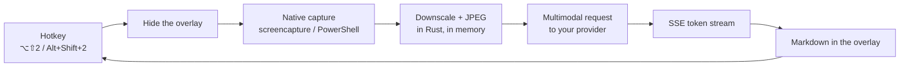
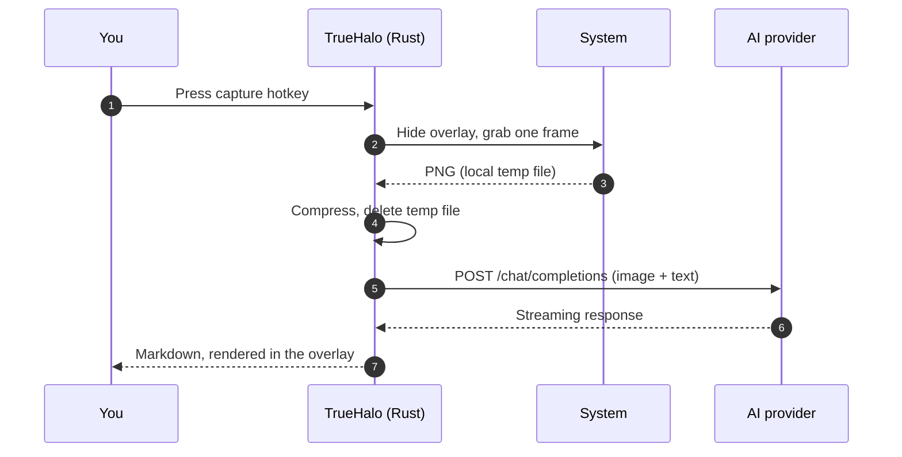

<div align="center">

<svg width="104" height="104" viewBox="0 0 104 104" xmlns="http://www.w3.org/2000/svg" role="img" aria-label="TrueHalo logo">
  <circle cx="52" cy="30" r="26" fill="none" stroke="#fbbf24" stroke-width="6"/>
  <rect x="18" y="34" width="68" height="52" rx="16" fill="#0f172a" stroke="#fbbf24" stroke-width="2"/>
  <text x="52" y="69" fill="#f8fafc" font-family="ui-sans-serif, system-ui, sans-serif" font-size="26" font-weight="700" text-anchor="middle">T</text>
</svg>

# TrueHalo

**A native, privacy-first AI screen overlay. 19 MB, not 200.**<br/>
Ask one question about what is on your screen — get an answer in a floating window that other apps cannot see.

[](https://www.gnu.org/licenses/gpl-3.0)
[](https://tauri.app)
[](https://www.rust-lang.org)
[](https://github.com/Neksand/TrueHalo/releases)
[](#platform-support)
[](#the-anti-electron-bet)

[Download](#install) · [Features](#features) · [Comparison](#truehalo-vs-cheating-daddy) · [How it works](#how-it-works) · [Roadmap](#roadmap)

</div>

<p align="center">
<svg width="860" height="392" viewBox="0 0 860 392" xmlns="http://www.w3.org/2000/svg" role="img" aria-label="TrueHalo overlay on a desktop">
  <rect width="860" height="392" rx="20" fill="#0b1020"/>
  <circle cx="720" cy="64" r="128" fill="#141c33"/>
  <circle cx="96" cy="344" r="150" fill="#0f1729"/>
  <rect x="24" y="24" width="812" height="344" rx="14" fill="none" stroke="#1e293b"/>

  <rect x="52" y="46" width="756" height="300" rx="16" fill="#0f172a" stroke="#2b3652"/>
  <path d="M52 62 a16 16 0 0 1 16 -16 h724 a16 16 0 0 1 16 16 v22 h-756 z" fill="#172036"/>
  <circle cx="78" cy="65" r="5" fill="#ff5f57"/>
  <circle cx="96" cy="65" r="5" fill="#febc2e"/>
  <circle cx="114" cy="65" r="5" fill="#28c840"/>
  <text x="140" y="70" fill="#e2e8f0" font-family="ui-sans-serif, system-ui, sans-serif" font-size="13" font-weight="600">TrueHalo AI Overlay</text>

  <rect x="618" y="55" width="168" height="20" rx="10" fill="#1e2a44"/>
  <text x="702" y="69" fill="#9fb3d1" font-family="ui-sans-serif, system-ui, sans-serif" font-size="10" text-anchor="middle">OpenRouter · vision model</text>

  <rect x="76" y="92" width="470" height="58" rx="12" fill="#141d31" stroke="#243149"/>
  <text x="94" y="116" fill="#cbd5e1" font-family="ui-sans-serif, system-ui, sans-serif" font-size="12">Your screenshot is analyzed locally, then sent</text>
  <text x="94" y="134" fill="#cbd5e1" font-family="ui-sans-serif, system-ui, sans-serif" font-size="12">to the provider you chose — nothing else leaves.</text>

  <rect x="76" y="164" width="286" height="46" rx="10" fill="#0b1220" stroke="#fbbf24"/>
  <rect x="90" y="176" width="34" height="22" rx="4" fill="#1e293b"/>
  <circle cx="100" cy="183" r="3" fill="#fbbf24"/>
  <path d="M94 194 l10 -7 l7 5 l8 -9" fill="none" stroke="#94a3b8" stroke-width="2"/>
  <text x="134" y="185" fill="#e2e8f0" font-family="ui-sans-serif, system-ui, sans-serif" font-size="11" font-weight="600">region · 1180 × 640</text>
  <text x="134" y="200" fill="#94a3b8" font-family="ui-sans-serif, system-ui, sans-serif" font-size="10">412 KB after compression</text>

  <rect x="404" y="228" width="386" height="46" rx="12" fill="#26344f"/>
  <text x="422" y="256" fill="#e2e8f0" font-family="ui-sans-serif, system-ui, sans-serif" font-size="12">What does this error mean?</text>

  <rect x="76" y="292" width="714" height="36" rx="10" fill="#111a2c" stroke="#243149"/>
  <text x="94" y="315" fill="#64748b" font-family="ui-sans-serif, system-ui, sans-serif" font-size="11">Ask about your screen…</text>
  <rect x="742" y="300" width="34" height="20" rx="10" fill="#fbbf24"/>
  <text x="759" y="314" fill="#111827" font-family="ui-sans-serif, system-ui, sans-serif" font-size="10" font-weight="700" text-anchor="middle">↵</text>

  <rect x="560" y="360" width="248" height="22" rx="11" fill="#111a2c" stroke="#334155" stroke-dasharray="4 4"/>
  <text x="684" y="375" fill="#94a3b8" font-family="ui-sans-serif, system-ui, sans-serif" font-size="10" text-anchor="middle">invisible to OBS, Zoom, QuickTime</text>
</svg>
</p>

<p align="center"><sub>The overlay stays out of other apps' recordings and never appears in its own screenshots.</sub></p>

## The anti-Electron bet

Most AI overlay apps ship a full Chromium runtime. TrueHalo ships **a Rust core and the WebView your OS already has**.

| | Typical Electron overlay | TrueHalo |
|---|---|---|
| Installer | 200+ MB | **~19 MB** |
| Cold start | several seconds | near-instant |
| Idle RAM | hundreds of MB | a fraction of that |
| Runtime | bundled Chromium | system WebView |

Same idea, a tenth of the footprint — and no second browser living on your disk.

<p align="center">
<svg width="860" height="150" viewBox="0 0 860 150" xmlns="http://www.w3.org/2000/svg" role="img" aria-label="Installer size comparison">
  <rect width="860" height="150" rx="16" fill="#0b1020"/>
  <text x="28" y="34" fill="#e2e8f0" font-family="ui-sans-serif, system-ui, sans-serif" font-size="13" font-weight="600">Installer size</text>
  <text x="28" y="74" fill="#94a3b8" font-family="ui-sans-serif, system-ui, sans-serif" font-size="12">Electron overlay</text>
  <rect x="180" y="60" width="620" height="22" rx="11" fill="#334155"/>
  <text x="812" y="76" fill="#cbd5e1" font-family="ui-sans-serif, system-ui, sans-serif" font-size="11" text-anchor="end">200+ MB</text>
  <text x="28" y="116" fill="#f8fafc" font-family="ui-sans-serif, system-ui, sans-serif" font-size="12" font-weight="600">TrueHalo</text>
  <rect x="180" y="102" width="74" height="22" rx="11" fill="#fbbf24"/>
  <text x="266" y="118" fill="#fbbf24" font-family="ui-sans-serif, system-ui, sans-serif" font-size="11" font-weight="700">19 MB</text>
</svg>
</p>

## Why TrueHalo

- **On demand, not always-on.** No background screen reading, no microphone, no timers. One hotkey, one frame, one answer.
- **Your keys never touch the UI.** API keys live in the system credential store and are used only by the Rust backend.
- **Provider freedom.** OpenRouter, Google Gemini and OpenAI — vision models from any of them, swapped in two clicks.
- **Built for the overlay life.** Global show/hide hotkey, real window transparency, accessory mode, remembered geometry.
- **Quiet by default.** No telemetry, no analytics, no accounts.

## Platform support

| Platform | Status | Installer |
|---|---|---|
| macOS 13+ · **Apple Silicon (arm64) only** | ✅ Available | `TrueHalo-0.1.0-arm64.dmg` |
| Windows 10 2004+ / 11 · x64 | ✅ Available | `TrueHalo_0.1.0_x64-setup.exe` (NSIS) |

> **macOS note:** TrueHalo targets Apple Silicon exclusively — macOS 13 Ventura or newer, M1 or later.

The UI and the Rust core are platform-neutral. The macOS backend uses AppKit and the Keychain;
the Windows backend uses Win32 (DWM acrylic, display affinity) and the Credential Manager.

## Features

### AI core
- **Three providers out of the box** — OpenRouter, Google Gemini, OpenAI, with a live model catalog.
- **Streaming answers** with instant cancellation (`Esc` or Stop).
- **Vision-native** — screenshots go straight to multimodal models such as Claude, Gemini and GPT-4o.
- **Token awareness** — per-message and per-session usage; only the newest screenshot is sent in full,
  older ones are replaced with a lightweight placeholder.

### Capture
- **Two hotkeys** — region and full-screen.
- **Compressed before upload** — a raw Retina PNG (10–20 MB) usually lands under 1 MB with the
  Balanced preset (Quality / Balanced / Speed).
- **Never captures itself** — the overlay hides before the shutter.
- **Stable screen-recording grant** — builds are signed with a persistent identity, so macOS does not
  re-ask after every rebuild.

### Window & privacy
- **True transparency** — the opacity slider maps 1:1 to window alpha (5–100 %).
- **Optional frosted glass** for readability at high transparency.
- **Invisible to recorders** — excluded from OBS, Zoom, QuickTime and friends.
  (`NSWindowSharingNone` on macOS, `WDA_EXCLUDEFROMCAPTURE` on Windows 10 2004+.)
- **Accessory mode** — hide from the Dock / taskbar and keep a tray icon.
- **No telemetry, ever.**

<p align="center">
<svg width="860" height="330" viewBox="0 0 860 330" xmlns="http://www.w3.org/2000/svg" role="img" aria-label="TrueHalo settings mockup">
  <rect width="860" height="330" rx="18" fill="#0b1020"/>
  <rect x="24" y="22" width="812" height="286" rx="14" fill="#0f172a" stroke="#2b3652"/>
  <text x="48" y="56" fill="#f8fafc" font-family="ui-sans-serif, system-ui, sans-serif" font-size="14" font-weight="700">Settings</text>

  <rect x="48" y="72" width="240" height="36" rx="9" fill="#172036" stroke="#2b3652"/>
  <rect x="72" y="86" width="72" height="8" rx="4" fill="#64748b"/>
  <text x="72" y="120" fill="#64748b" font-family="ui-sans-serif, system-ui, sans-serif" font-size="10" transform="translate(0,-2)">opacity</text>
  <rect x="72" y="96" width="150" height="6" rx="3" fill="#334155"/>
  <rect x="72" y="96" width="108" height="6" rx="3" fill="#fbbf24"/>
  <circle cx="180" cy="99" r="7" fill="#fbbf24"/>

  <rect x="48" y="128" width="240" height="72" rx="9" fill="#141d31" stroke="#243149"/>
  <text x="66" y="152" fill="#cbd5e1" font-family="ui-sans-serif, system-ui, sans-serif" font-size="11" font-weight="600">Excluded from recordings</text>
  <text x="66" y="172" fill="#94a3b8" font-family="ui-sans-serif, system-ui, sans-serif" font-size="10">Windows 10 2004+ · macOS 13+</text>
  <rect x="228" y="140" width="42" height="20" rx="10" fill="#fbbf24"/>
  <circle cx="259" cy="150" r="8" fill="#111827"/>

  <rect x="48" y="214" width="240" height="72" rx="9" fill="#141d31" stroke="#243149"/>
  <text x="66" y="238" fill="#cbd5e1" font-family="ui-sans-serif, system-ui, sans-serif" font-size="11" font-weight="600">Keys</text>
  <text x="66" y="258" fill="#94a3b8" font-family="ui-sans-serif, system-ui, sans-serif" font-size="10">System credential store</text>
  <rect x="196" y="226" width="74" height="20" rx="10" fill="#14351f" stroke="#1f6b3a"/>
  <text x="233" y="240" fill="#4ade80" font-family="ui-sans-serif, system-ui, sans-serif" font-size="9" text-anchor="middle">connected</text>

  <rect x="312" y="72" width="500" height="214" rx="12" fill="#101a2c" stroke="#243149"/>
  <text x="336" y="102" fill="#e2e8f0" font-family="ui-sans-serif, system-ui, sans-serif" font-size="12" font-weight="700">AI providers &amp; models</text>

  <rect x="336" y="118" width="452" height="48" rx="9" fill="#16213a"/>
  <circle cx="358" cy="142" r="8" fill="#fbbf24"/>
  <text x="376" y="138" fill="#f8fafc" font-family="ui-sans-serif, system-ui, sans-serif" font-size="11" font-weight="600">OpenRouter</text>
  <text x="376" y="154" fill="#94a3b8" font-family="ui-sans-serif, system-ui, sans-serif" font-size="10">key stored in the system keychain</text>
  <rect x="700" y="132" width="70" height="20" rx="10" fill="#14351f" stroke="#1f6b3a"/>
  <text x="735" y="146" fill="#4ade80" font-family="ui-sans-serif, system-ui, sans-serif" font-size="9" text-anchor="middle">active</text>

  <rect x="336" y="176" width="452" height="48" rx="9" fill="#131c30" stroke="#243149"/>
  <circle cx="358" cy="200" r="8" fill="#334155"/>
  <text x="376" y="196" fill="#cbd5e1" font-family="ui-sans-serif, system-ui, sans-serif" font-size="11" font-weight="600">Google Gemini</text>
  <text x="376" y="212" fill="#64748b" font-family="ui-sans-serif, system-ui, sans-serif" font-size="10">add a key to enable</text>

  <rect x="336" y="234" width="452" height="38" rx="9" fill="#131c30" stroke="#243149"/>
  <circle cx="358" cy="253" r="8" fill="#334155"/>
  <text x="376" y="257" fill="#cbd5e1" font-family="ui-sans-serif, system-ui, sans-serif" font-size="11">OpenAI</text>
</svg>
</p>

## TrueHalo vs Cheating Daddy

[Cheating Daddy](https://github.com/sohzm/cheating-daddy) is the project that popularized this idea.
TrueHalo is an **independent implementation** for people who want the same workflow with a much
smaller footprint, provider freedom and stricter privacy defaults.

| | Cheating Daddy | TrueHalo |
|---|---|---|
| Runtime | Electron | Tauri 2 (Rust + system WebView) |
| Installer | Electron bundle | **~19 MB** |
| AI providers | Google Gemini Live | OpenRouter · Google Gemini · OpenAI |
| Screen analysis | Continuous during a session | On demand: region or full-screen hotkey |
| Audio capture | System audio + microphone | Not included — screen only, by design |
| Assistant profiles | 5 fixed presets | Free-form chat today · **context injection planned** |
| Overlay privacy | Transparent, click-through | Hidden from other apps' recordings, accessory mode |
| API key storage | — | System credential store, never in the WebView |
| Platforms | macOS · Windows · Linux | macOS (arm64) · Windows (x64) |
| License | GPL-3.0 | GPL-3.0 |

## Features that are coming next

> These are **not shipped yet**. They are on the roadmap, and they are the reason TrueHalo is more
> than a screenshot chat box.

### Assistant profiles + context injection
Drop in your own knowledge and let the model answer with it: a resume before an interview, a product
brief before a sales call, a runbook before an incident. Upload documents once, and every screenshot
question is answered with that context attached — no copy-pasting the same background into the chat.

This is the feature we consider the biggest advantage over preset-only assistants: **your context,
not a fixed prompt written by someone else.** File uploads and the knowledge base are in design.

### Smart token optimization
Screenshots and history are the two biggest cost drivers. The plan: reuse compressed visual context,
deduplicate repeated frames and trim history intelligently — **lower token spend with the same answer
quality**, instead of silently degrading responses.

### Major performance optimization
Further work on the Rust side: smaller memory peaks while decoding screenshots, fewer allocations in
the streaming path, and a lower idle footprint. Target: stay fast on a laptop that is already running
a meeting, an IDE and forty browser tabs.

## Install

### macOS — Apple Silicon only

**Requirements:** macOS 13 Ventura or newer, Apple Silicon (M1 or later).

1. Download `TrueHalo-0.1.0-arm64.dmg` from [Releases](https://github.com/Neksand/TrueHalo/releases).
2. Open the DMG and drag **TrueHalo** into **Applications**.
3. Launch it. macOS will warn that the app cannot be verified — this is expected. The build is signed
   with a local certificate, not a paid Apple Developer ID:

   **macOS 15 (Sequoia) and newer**
   1. Open **System Settings → Privacy & Security**.
   2. Scroll to the *Security* section and click **Open Anyway** next to TrueHalo.
   3. Confirm with your password / Touch ID, then click **Open**.

   **macOS 13–14**
   1. Right-click (or Control-click) **TrueHalo.app** in Applications.
   2. Choose **Open**, then **Open** again in the dialog.

   **Terminal alternative** (removes the quarantine flag without dialogs):
   ```bash
   xattr -dr com.apple.quarantine /Applications/TrueHalo.app
   ```

4. Grant **Screen Recording** when asked: **System Settings → Privacy & Security → Screen & System
   Audio Recording** → enable **TrueHalo** → restart the app.

### Windows — x64

**Requirements:** Windows 10 version 2004 or newer, or Windows 11 (x64). The installer downloads
WebView2 automatically if it is missing.

1. Download `TrueHalo_0.1.0_x64-setup.exe` from [Releases](https://github.com/Neksand/TrueHalo/releases).
2. Run it. If SmartScreen appears ("Windows protected your PC"), click **More info → Run anyway**.
   The installer is not signed with a commercial Authenticode certificate.
3. Launch TrueHalo from the Start menu or the tray icon. No screen-recording permission is required.

Region capture opens a dimmed selection overlay — drag a rectangle, or press `Esc` to cancel.

### First run

1. Click the gear icon → **AI Providers & Models**.
2. Pick a provider and paste a key: [OpenRouter](https://openrouter.ai/keys) ·
   [Google AI Studio](https://aistudio.google.com/app/apikey) ·
   [OpenAI](https://platform.openai.com/api-keys).
3. Press **Save**. The key goes straight into the system credential store — the UI never receives it.
4. Choose a model, close Settings, and press `Alt/Option + Space` whenever you need the overlay.

## Hotkeys

| Shortcut | Action |
|---|---|
| `⌥Space` / `Alt+Space` | Show / hide the overlay (global) |
| `⌥⇧2` / `Alt+Shift+2` | Capture a region and attach it |
| `⌥⇧3` / `Alt+Shift+3` | Capture the full screen and attach it |
| `Esc` | Stop streaming / quick-hide |
| `↵` | Send message |
| `⇧↵` | New line |

## How it works





Platform code is quarantined behind small modules (`overlay`, `capture`, `auth`), so the frontend and
the streaming core are shared. Native UI calls are marshalled to the main thread, window geometry is
flushed to SQLite from a background thread, and the overlay is hidden without destroying its window.

## Privacy & security

- **Keys** — system credential store (macOS Keychain, Windows Credential Manager). Existence checks
  read attributes only, so Settings never asks for your login password. A one-click **Fix** in
  Settings → Screen Recording & Privacy re-binds keys created by older builds.
- **Never in the WebView** — the React layer can start a request, but it never receives a key. Keys are
  read by Rust at request time and stay in memory only for that call.
- **Network** — direct HTTPS to the provider you chose. No proxy, no telemetry, no analytics.
- **Screen** — captured only after an explicit hotkey, compressed locally, temp file deleted right
  after it is read. Nothing is recorded continuously.
- **Overlay** — excluded from other apps' captures; strict CSP; Markdown rendered as text nodes.

## Troubleshooting

| Symptom | Fix |
|---|---|
| macOS: “TrueHalo is damaged and can’t be opened” | Run `xattr -dr com.apple.quarantine /Applications/TrueHalo.app`, then open again |
| macOS: no **Open Anyway** button | Try launching the app once, then reopen Privacy & Security; or use the Terminal command above |
| Screenshots keep asking for permission | System privacy settings → toggle TrueHalo **off and on** → restart the app |
| A password prompt appears when opening Settings | Settings → Screen Recording & Privacy → **Fix** (choose **Always Allow** once) |
| Windows: “Windows protected your PC” | SmartScreen → **More info** → **Run anyway** |
| Windows: a protected video captures as black | DRM windows cannot be captured by any screen recorder |
| Hotkeys do nothing | Another app owns the shortcut; quit it or change the global shortcut |
| Model list is empty | The provider rejected the key (401/429) — check the key and your quota |

Logs: `~/Library/Logs/TrueHalo/truehalo.log` on macOS.

## Roadmap

- [x] Windows build — Credential Manager, native capture backend, NSIS installer
- [ ] **Assistant profiles + context injection** — upload files, build a personal knowledge base,
      answer with your context attached
- [ ] **Smart token optimization** — lower token spend with the same answer quality
- [ ] **Major performance optimization** — further reduction of CPU and RAM usage
- [ ] Code signing for both platforms (Apple Developer ID, Authenticode)
- [ ] Optional click-through mode
- [ ] Local models via Ollama

## Tech stack

| Layer | Technology |
|---|---|
| Shell | Tauri 2 |
| Backend | Rust, Tokio, reqwest, rusqlite |
| Frontend | React 18, TypeScript, Vite, Tailwind CSS |
| Capture | macOS `screencapture` · Windows PowerShell + WinForms |
| Credentials | macOS Keychain · Windows Credential Manager |
| Window | AppKit on macOS · Win32 / DWM on Windows |

```text
src/                  React UI (chat, providers, capture, settings)
src-tauri/src/
├── ai/               provider clients (OpenRouter, Gemini, OpenAI) + SSE streaming
├── auth/             credential storage (Keychain / Credential Manager)
├── capture/          capture backends, compression, permission handling
├── commands/         typed IPC surface
├── storage/          SQLite (sessions, messages, preferences)
├── overlay.rs        safe show/hide/is_visible for the overlay
└── macos.rs          Objective-C runtime helpers (macOS backend)
scripts/              build, signing and packaging
```

## Build from source

macOS:

```bash
git clone https://github.com/Neksand/TrueHalo.git
cd TrueHalo
npm install

# One-time: stable local signing identity (keeps screen recording across rebuilds)
npm run sign:setup

# Build, sign and install
npm run app:install
```

Prerequisites: Xcode Command Line Tools (`xcode-select --install`), Node.js 18+, Rust stable.

Windows (PowerShell, MSVC toolchain + Visual Studio Build Tools):

```powershell
git clone https://github.com/Neksand/TrueHalo.git
cd TrueHalo
npm install
npm run tauri build -- --bundles nsis
```

Development loop:

```bash
npm run tauri dev     # hot reload
npm run build         # type-check + production frontend
cargo test --manifest-path src-tauri/Cargo.toml
```

> `npm run tauri dev` runs an unsigned debug binary, so macOS cannot persist the screen-recording
> permission for it. Test capture with the signed `/Applications` build.

## Credits

- Inspired by **[Cheating Daddy](https://github.com/sohzm/cheating-daddy)** by
  [@sohzm](https://github.com/sohzm). TrueHalo is an independent implementation and shares no code
  with it; the comparison above reflects its public README.
- Built with [Tauri](https://tauri.app), [React](https://react.dev) and
  [Tailwind CSS](https://tailwindcss.com).

## License

GPL-3.0 © TrueHalo contributors.

TrueHalo is free software: you can redistribute it and/or modify it under the terms of the GNU General
Public License as published by the Free Software Foundation, either version 3 of the License, or (at
your option) any later version. See the `LICENSE` file in this repository.
